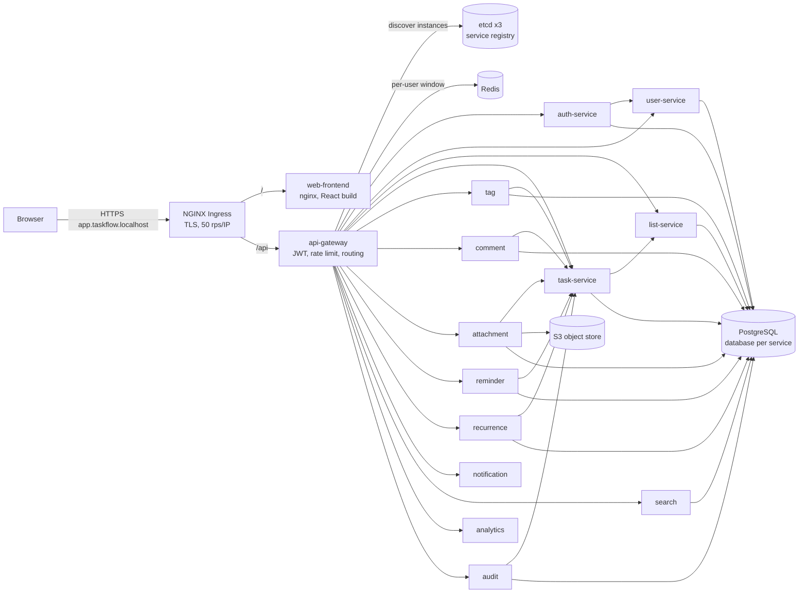
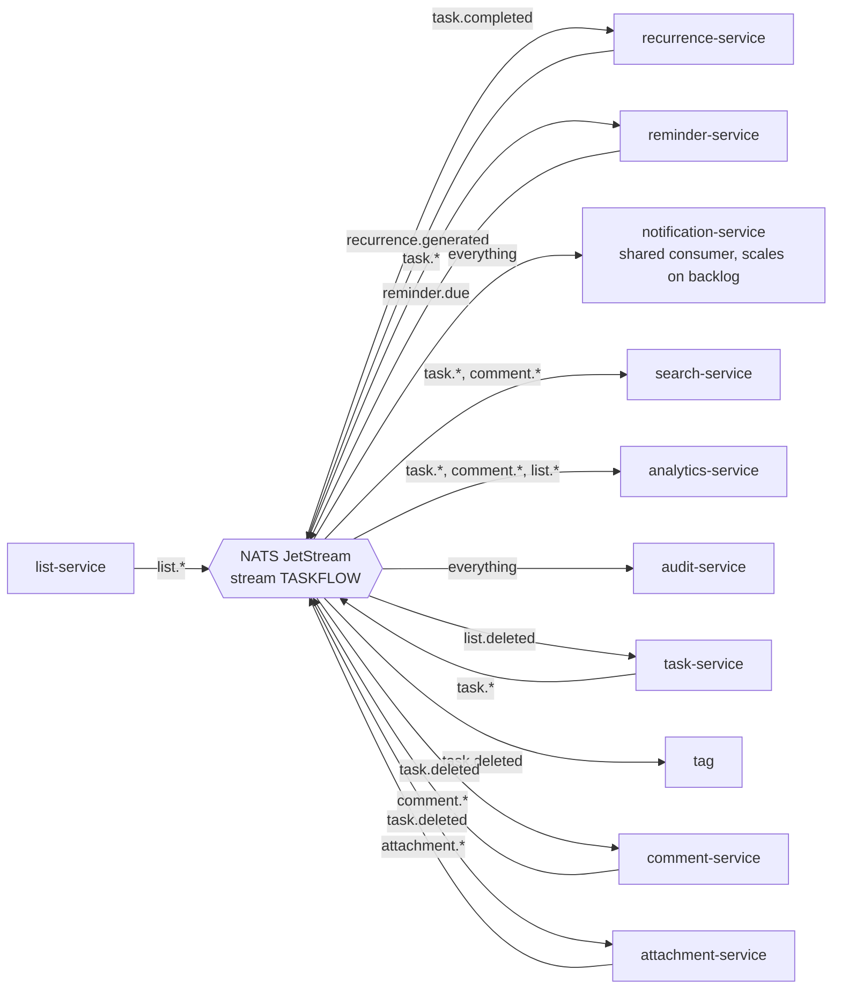
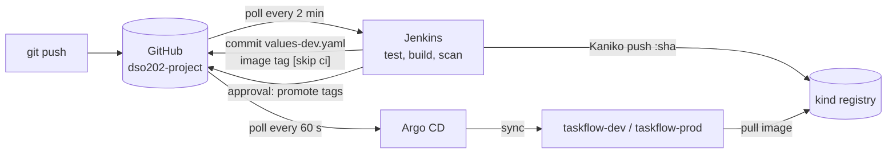
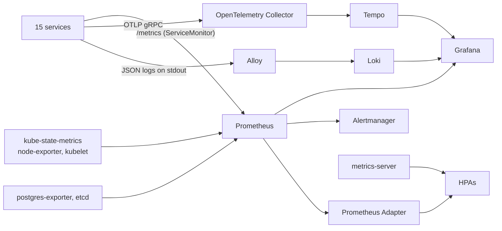

# TaskFlow architecture

## 1. Request path

* The browser only talks to one origin: the Ingress sends `/api` to the
  gateway and everything else to the frontend, so no CORS is needed.
* Only the gateway validates JWTs. It forwards the user id in `X-User-Id`
  (after removing any client-sent value); default-deny NetworkPolicies make
  the gateway and the listed service-to-service calls the only way in.
* **Access control** lives in one place: list-service owns list roles
  (owner / editor / viewer); task-service maps a task to its list. Services
  that hang data off a task ask task-service (`taskflow_common.access`,
  cached for 5 s).
* **Service discovery**: each Pod registers `/taskflow/services/<name>/<pod>`
  in etcd under a 15 s lease and keeps it alive; the gateway picks a live
  instance and falls back to Kubernetes DNS. A circuit breaker returns 503
  immediately for 10 s after an upstream fails, so one dead service cannot
  tie up the gateway.
* **Dynamic configuration**: the gateway reads its rate limit from
  `/taskflow/config/api-gateway/rate_limit_per_minute` every 10 s
  (`etcdctl put` changes it live; the platform chart seeds it from Git).

## 2. Events

* One stream, durable **pull consumers** per service: a restarted Pod
  resumes where it stopped, and replicas of one service share a consumer
  (each message to exactly one replica). That is what lets
  notification-service scale out on its backlog.
* At-least-once delivery: handlers are idempotent (audit dedupes on event
  id; recurrence moves its rule in the same transaction; reminders use
  `FOR UPDATE SKIP LOCKED`).
* The W3C trace context travels in the message headers, so a trace follows
  a request across the asynchronous hop (gateway -> task-service -> NATS ->
  notification-service).

## 3. Delivery

* **Argo CD owns the cluster.** `deploy/argocd/root/root-app.yaml` (app of
  apps) creates every Application: Argo CD's own configuration, Sealed
  Secrets, ingress-nginx, the observability stack, and two ApplicationSets
  that generate `<env>-environment` (Kustomize), `<env>-platform` and
  `<env>-taskflow` (Helm) for dev and prod.
* **CI never touches the cluster.** Jenkins writes Git only; its agent
  ServiceAccount can merely watch rollouts. A rollback is `git revert`.
* **Secrets** are committed only as SealedSecrets; the plaintext and the
  controller's key backup live in `~/.taskflow-keys`, outside the repository.

## 4. Observability

* **Metrics**: RED per service (`http_server_requests_total`, duration
  histogram with the route *template* as a label, so cardinality stays
  bounded), business metrics (tasks, notifications, active users, backlog).
* **Traces**: FastAPI, httpx, asyncpg and redis instrumentation plus NATS
  producer/consumer spans; 50% sampling in prod.
* **Logs**: one JSON object per line with `trace_id`; Alloy promotes
  `level` and `service` to labels and keeps `trace_id` as structured
  metadata, so a Grafana log line opens its trace (and a span its logs).

## 5. Security layers

| Layer | Control |
|---|---|
| Edge | TLS at the Ingress; per-IP rate limit; only 80/443 published |
| Identity | JWT (15 min) + rotating refresh tokens; bcrypt; gateway-only validation |
| Network | default-deny NetworkPolicy per namespace; each service allows only its callers and its dependencies |
| Workload | Pod Security "restricted" enforced; non-root, read-only root FS, no capabilities, seccomp; no ServiceAccount tokens |
| Kubernetes RBAC | developer (read + exec in dev, read-only in prod), viewer, CI read-only; `scripts/rbac-check.sh` |
| Argo CD RBAC | AppProjects restrict sources/destinations/cluster-scoped kinds; local accounts with roles |
| Data | database per service; audit log append-only by trigger; SealedSecrets |
| Supply chain | pinned image tags and chart versions; Trivy gate on fixable CRITICAL CVEs |
